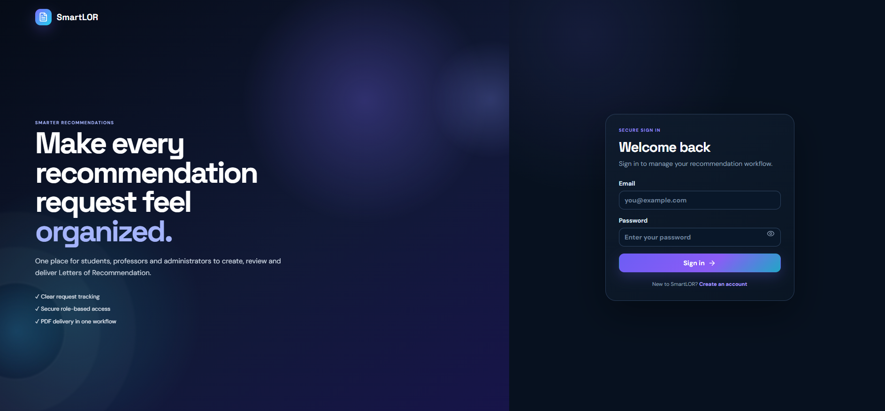
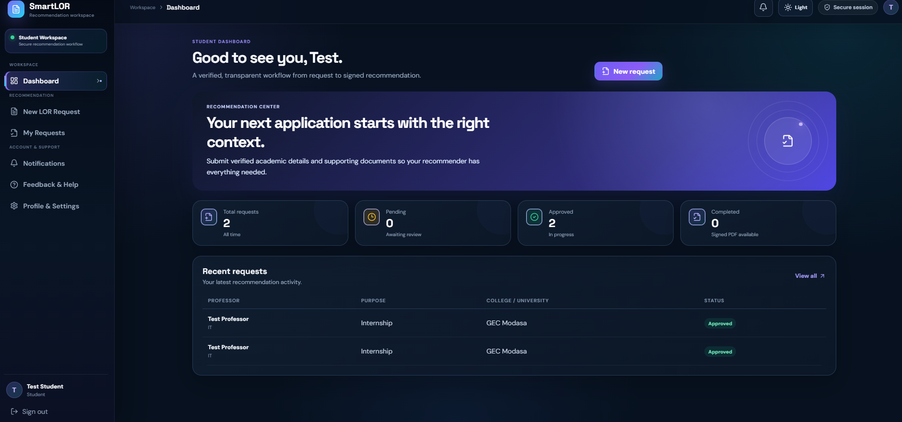
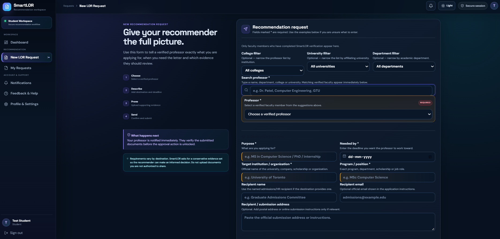
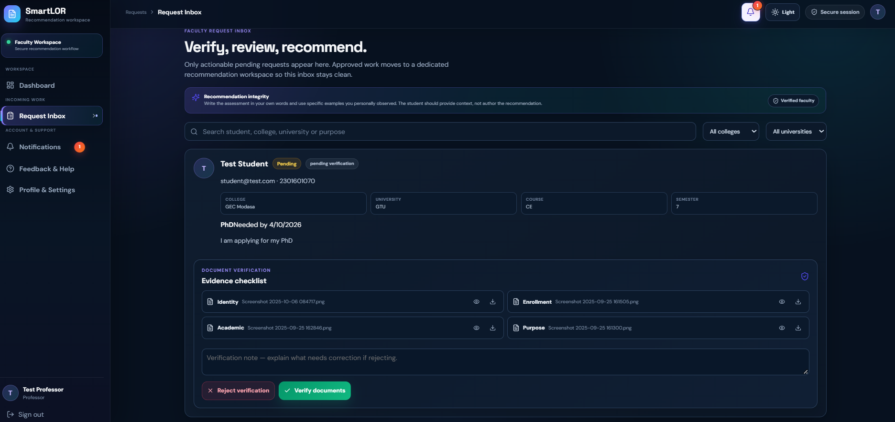
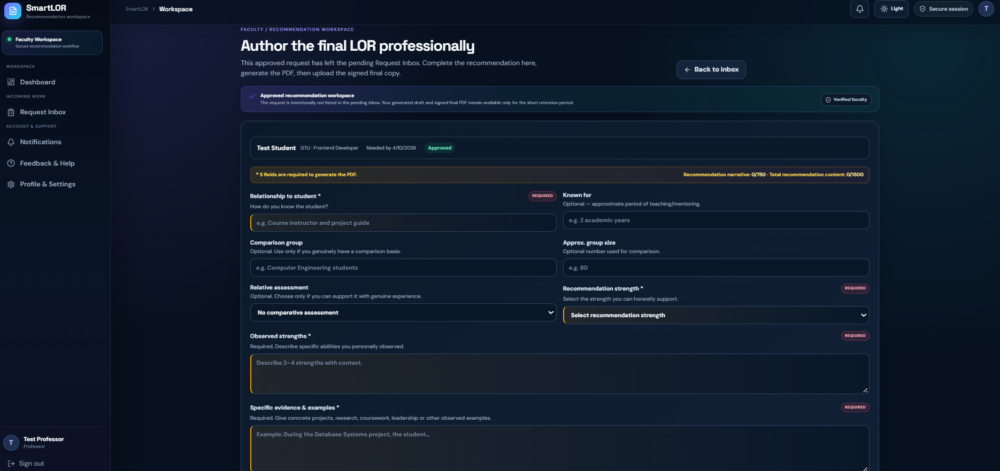
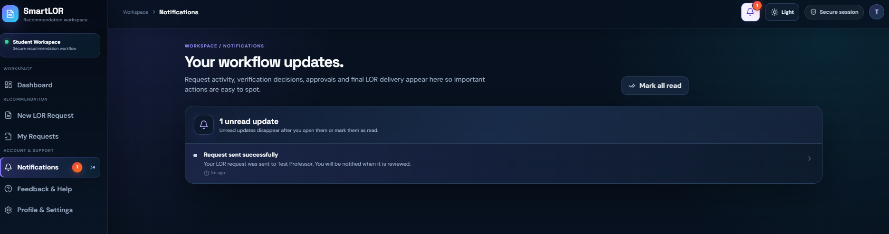

# SmartLOR

SmartLOR is a secure, role-based web application for managing **Letters of Recommendation (LORs)** between students, verified professors, and administrators.

## What is an LOR?

A **Letter of Recommendation** is a formal letter written by someone who knows a student academically or professionally. It describes the student's abilities, achievements, character, and suitability for an opportunity such as higher studies, scholarships, internships, or jobs. In SmartLOR, the recommender remains the author of the recommendation; students provide the context and supporting evidence.

## Main workflow

**Student:** Register → choose a verified professor → submit purpose/deadline and 4 required documents → track the request.

**Professor:** Verify student documents → approve/reject → complete the recommendation workspace → generate a draft PDF → review/sign → upload the final signed LOR.

**Admin:** Review faculty verification → approve/reject faculty access → oversee users, requests, and verification activity.

Approved work leaves the actionable professor inbox and continues in a protected recommendation workspace. The workspace remains available until the final signed PDF is uploaded or the retention window expires, including after a draft PDF is generated. Student requests are separated into **Pending**, **In progress**, **Approved**, and **Rejected** states.

## Key features

- Role-based Student / Professor / Admin access
- Faculty verification before professors can receive LOR requests
- Search-as-you-type verified professor selection with college, university, and department filters
- Four-document student evidence workflow
- Four-document professor verification workflow
- Document verification before LOR approval
- Recommendation form with required fields and word limits
- SmartLOR-branded draft PDF generation and signed final PDF upload
- Notification center with synchronized unread state
- Manual deletion of pending requests
- Automatic cleanup of short-lived documents and reviewed workflows
- Light / Dark theme
- Responsive SaaS-style UI

## Data retention

- Pending request records: **not automatically deleted**; manual deletion only
- Supporting request documents: maximum **7 days**
- Professor verification documents: maximum **7 days**
- Generated draft PDFs: maximum **7 days**
- Final signed LOR PDFs: maximum **7 days from upload**
- Reviewed request records: maximum **7 days**
- Read notifications: 90 days by default

The backend caps the request/PDF/document retention settings at 7 days.

## Local setup

### Backend

```bash
cd backend
npm install
```

Copy `backend/.env.example` to `backend/.env` and set your own `JWT_SECRET`, MongoDB connection, and admin credentials.

```bash
npm run dev
```

### Frontend

```bash
cd frontend
npm install
npm run dev
```

The default development URLs are:

- Frontend: `http://localhost:5173`
- Backend API: `http://localhost:5000/api`
- MongoDB: `mongodb://127.0.0.1:27017/smartLOR`

## Security notes

- Passwords are hashed with bcrypt.
- JWT authentication and role-based authorization protect API routes.
- Private documents are served through authenticated API endpoints, not a public uploads route.
- Upload types and file sizes are restricted.
- Helmet, CORS restrictions, request-size limits, and API rate limiting are enabled.
- Sensitive files are automatically cleaned according to the retention policy.
- **Never commit `.env`, real credentials, uploaded documents, `node_modules`, `dist`, or generated ZIP files to GitHub.** Use the `.env.example` files instead.

Before any public deployment, replace all local/demo secrets and run dependency/security checks such as `npm audit`.

## Screenshots

Place the following 6 screenshots in `docs/screenshots/`:

### 1. Login


### 2. Student Dashboard


### 3. New LOR Request


### 4. Professor Request Inbox


### 5. Recommendation Workspace


### 6. Notifications


## Project structure

```text
SmartLor_final/
├── backend/                 # Express API, MongoDB models, auth, files, PDF generation
│   ├── controllers/
│   ├── middleware/
│   ├── models/
│   ├── routes/
│   ├── utils/
│   ├── .env.example
│   └── index.js
├── frontend/                # React + Vite application
│   ├── src/
│   │   ├── components/
│   │   ├── context/
│   │   └── pages/
│   └── .env.example
└── docs/
    └── screenshots/
```

## Recommendation integrity

SmartLOR helps organize the evidence and workflow, but the recommendation itself must be written truthfully by the authorized recommender. The generated draft is not an institutional seal or digital signature; the final LOR should be reviewed and signed through the institution's approved process.
